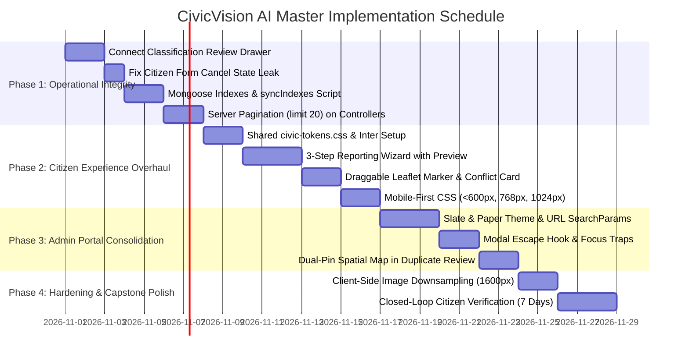

# CivicVision AI — Comprehensive UI/UX Synthesis, Comparative Review, and Master Implementation Plan

> **Document Type:** Master UI/UX Redesign & Technical Architecture Plan  
> **Project:** CivicVision AI (Final-Year Full-Stack Civic Issue Management Platform)  
> **Source Base:** Application Audit Report, Claude AI Review, Gemini AI Review, and Direct Codebase Verification  
> **Target Subsystems:** `frontend1` (Citizen Portal), `admin-frontend` (Municipal Portal), `backend1` (Express/MongoDB), `ai-service` (FastAPI/PyTorch)  
> **Status:** APPROVED SYNTHESIS — Ready for Implementation  

---

## 1. Executive Summary

CivicVision AI is an IEEE research-grounded platform designed to resolve a fundamental failure in municipal governance: citizens lack structured, transparent channels to report local infrastructure defects (potholes, street lighting, drainage blockages), while municipal engineers lack automated triage, duplicate suppression, and spatial defect analytics.

The platform possesses a strong engineering core:
- **MobileNetV3-Small Road Defect Classifier**: Genuinely trained and deployed on Render; evaluated on 2,408 held-out test images (Macro-F1 78.5%, pothole accuracy 88.1%, road damage accuracy 86.8%).
- **Two-Stage Duplicate Suppression**: Geodesic spherical indexing (`$nearSphere` 50m) paired with 512-dimensional CLIP ViT-B/32 cosine similarity vectors and deterministic fallback.
- **DBSCAN Spatial Hotspot Clustering**: Density-based spatial clustering identifying defect hotspots with SLA escalation tracking.
- **Audit Trails**: Full lifecycle tracking in Mongoose subdocuments (`statusHistory`) capturing state transitions, administrative identity, and rationale.

However, the user experience currently undermines these achievements. The citizen app (`frontend1`) looks like an early student assignment with raw primary colors (`#ff0000`, `#ffa500`, `#008000`), no responsive media queries, a monolithic 800-line single-page form, and no image preview. The admin app (`admin-frontend`) is an ultra-dense dark cyber-ops console (`#0b1120`, Inter, purple badges) with an **orphaned backend classification-review route** that leaves AI review flags permanently stuck.

This document synthesizes the recommendations from the previous audit, Claude AI, and Gemini AI against the live codebase. **The verdict is consolidation, not rewrite**: no migrations to Next.js or Tailwind, no unnecessary service additions, and strict prioritization of data integrity and core usability fixes before visual polish.

---

## 2. Summary of Claude's Recommendations

Claude’s review prioritized operational stability and architectural pragmatism:
1. **Prioritize Operational Failures over Aesthetics**: Fix the four critical breakages first: (a) orphaned classification review, (b) unbounded database queries and missing indexes, (c) form cancellation state leaks, and (d) zero mobile media queries.
2. **Unified "Slate & Paper" Design System**: Unify both frontends under a shared CSS token file (`civic-tokens.css`). Both apps share colors and typography (`Inter`), differing only in density (generous spacing for citizens, compact rows for municipal staff).
3. **Citizen 3-Step Wizard (`/report`)**: Replace monolithic [Dashboard.js](file:///e:/SEMESTER_IV/COURSES/FullStack%20Development/FSD_PROJECT/Community_Issue_Tracker/frontend1/src/pages/Dashboard.js) with a progressive stepper: Step 1 (Evidence & camera capture), Step 2 (Location with draggable pin & plain-language conflict resolution), Step 3 (Category, description & summary review).
4. **Client-Side Image Downsampling**: Downsample high-resolution phone photos (12–48MP) to 1600px max dimension (~400KB–900KB) using HTML5 Canvas before uploading, preventing Multer 5MB payload rejections.
5. **Closed-Loop Citizen Verification**: A 7-day post-resolution window allowing the reporting citizen to confirm *"Fixed"* or dispute *"Still Broken"*, reopening the issue with an audit entry.
6. **Admin Triage Drawer & Dual-Pin Map**: Replace the admin modal with a slide-over drawer connecting `PATCH /issues/:id/classification-review`, and embed an interactive mini-map in duplicate review showing both pins and a connecting distance line.

---

## 3. Summary of Gemini's Recommendations

Gemini’s review focused on accessibility, spatial data handling, and public-sector trust:
1. **WCAG 2.1 AA/AAA Accessibility Compliance**: Eliminate pure color indicators. Replace 10px status dots with compound badges containing both an icon and text label (e.g., `<Clock size={12}/> In Progress`). Eliminate low-contrast orange (`#ffa500`, 2.14:1 contrast) in favor of deep amber (`#92400e`, 5.8:1 contrast).
2. **Citizen Issue Tracking Timeline**: Upgrade `/my-reports` to display an institutional 4-node status stepper (`Reported` $\to$ `Triaged & Assigned` $\to$ `In Progress` $\to$ `Resolved`) showing the assigned department and public progress notes.
3. **Server-Side Filter Integration with URL SearchParams**: Replace the admin client-side `.filter()` over the full array with server query parameters (`/admin-dashboard/issues/filter`), binding state to browser URL search params for bookmarkable views.
4. **Modal Keyboard & Focus Standards**: Implement universal `Escape` key dismissal, backdrop click closing, and keyboard focus trapping (`useDialog` hook) across all admin drawers and candidate modals.
5. **Brand Identity Unification**: Eliminate the generic title *"Community Issue Reporter"* and rebrand the citizen portal to *"CivicVision AI"*, presenting a unified municipal public service.

---

## 4. Comparison and Disagreements

| Feature / Area | Claude Recommendation | Gemini Recommendation | Codebase Reality & Final Decision |
|---|---|---|---|
| **Admin UI Color Scheme** | Move admin completely to a light canvas (`#f8fafc`) with navy rails. | Keep high-contrast dark console for high-density night/day municipal operations. | **Hybrid Slate & Paper**: Deep Slate Navy (`#0f172a`) navigation frame, clean white card containers (`#ffffff`) on an off-white canvas (`#f8fafc`). Prevents daytime glare while maintaining dense tabular legibility. |
| **Location Privacy on Public Map** | Show street labels or rounded coordinates for privacy. | Exact pins required so citizens can see existing duplicates before reporting. | **Exact Defect Coordinates, Anonymized Citizen Identity**: Municipal repairs require pin-point accuracy (within 3m). Privacy is protected by stripping `userId`, citizen name, and email from public API projections, not by fuzzing road hazard coordinates. |
| **Category-to-Department Routing** | Create new API endpoint `GET /admin-dashboard/routing-suggestion?type=`. | Embed mapping directly in client or return within issue payload. | **Embed in Issue Payload & Client Helper**: The mapping matrix in [routing.service.js](file:///e:/SEMESTER_IV/COURSES/FullStack%20Development/FSD_PROJECT/Community_Issue_Tracker/backend1/services/routing.service.js#L54) is static (8 categories $\to$ 5 departments). A tiny shared lookup in the frontend avoids an unnecessary extra HTTP network hop on every category click. |
| **Downsampling vs EXIF Extraction** | Downsample with Canvas, but note that Canvas strips EXIF metadata. | Warn that downsampling might degrade OCR watermark detection. | **Sequence Guard**: Extract EXIF GPS using `exifr` from the **original raw file** first; store coordinates in state; then downsample for upload. Send original image buffer to OCR endpoint if printed text is small. |
| **Classification Review Actions** | Unsure if controller supports dismissal or only `confirmed_category`. | Propose adding dismissal action to controller. | **Code Verified**: [adminDashboard.controller.js:L411](file:///e:/SEMESTER_IV/COURSES/FullStack%20Development/FSD_PROJECT/Community_Issue_Tracker/backend1/controllers/adminDashboard.controller.js#L411) explicitly accepts `confirmed_category` and `reclassified`. It rejects other actions with 400. The UI must send one of these two verified action strings. |

---

## 5. Verification Against Current Source Code

Direct inspection of workspace files resolves all open questions raised in previous reports:

### 1. Classification Review Endpoint Contract
- **File**: [backend1/controllers/adminDashboard.controller.js:L402-452](file:///e:/SEMESTER_IV/COURSES/FullStack%20Development/FSD_PROJECT/Community_Issue_Tracker/backend1/controllers/adminDashboard.controller.js#L402-L452)
- **Code Finding**: `resolveClassificationReview` expects `req.body`:
  ```javascript
  const { action, classificationReviewResolution, reviewNotes, department, type } = req.body;
  const rawAction = action || classificationReviewResolution || "confirmed_category";
  if (!["confirmed_category", "reclassified"].includes(rawAction)) { ... }
  ```
- **Resolution**: The controller strictly requires `action: "confirmed_category"` or `action: "reclassified"`. It clears `needsClassificationReview = false` and recomputes `needsReview = Boolean(issue.needsDuplicateReview)`. The admin drawer must bind to these exact payload keys.

### 2. Location Schema & 2dsphere Index
- **File**: [backend1/models/Issue.js:L46-76, L385, L411](file:///e:/SEMESTER_IV/COURSES/FullStack%20Development/FSD_PROJECT/Community_Issue_Tracker/backend1/models/Issue.js#L46-L76)
- **Code Finding**:
  - `pointSchema` defines GeoJSON `{ type: "Point", coordinates: [lng, lat] }` with virtual `lat`/`lng` getters.
  - Line 411 declares: `issueSchema.index({ location: "2dsphere" });`.
  - Line 385 declares: `{ autoIndex: false }`.
- **Resolution**: The 2dsphere index is present in schema code, but because `autoIndex: false` is configured for production, Mongoose does not build it automatically on connection. Running an explicit `Issue.syncIndexes()` script is mandatory.

### 3. Citizen Form Cancellation State Leak
- **File**: [frontend1/src/pages/Dashboard.js:L442-458](file:///e:/SEMESTER_IV/COURSES/FullStack%20Development/FSD_PROJECT/Community_Issue_Tracker/frontend1/src/pages/Dashboard.js#L442-L458)
- **Code Finding**: The `.cancel-btn` handler resets map markers, extraction flags, and file input value, but **does not reset** `newIssue` (`type`, `description`, `image`).
- **Resolution**: Confirmed bug. Structurally resolved by introducing a unified draft reducer and single `resetReport()` function.

### 4. Admin Filtering Implementation
- **File**: [admin-frontend/src/pages/Dashboard.js:L209, L395-435](file:///e:/SEMESTER_IV/COURSES/FullStack%20Development/FSD_PROJECT/Community_Issue_Tracker/admin-frontend/src/pages/Dashboard.js#L209)
- **Code Finding**: Line 209 executes `API.get("/admin-dashboard/issues")`. Lines 395–435 filter the resulting array client-side. The backend endpoint `/admin-dashboard/issues/filter` ([adminDashboard.routes.js:L26](file:///e:/SEMESTER_IV/COURSES/FullStack%20Development/FSD_PROJECT/Community_Issue_Tracker/backend1/routes/adminDashboard.routes.js#L26)) is never called.
- **Resolution**: Confirmed inefficiency. Update client to pass query parameters to the backend and remove client-side array filtering.

### 5. Mobile Responsiveness in Citizen App
- **Files**: [frontend1/src/pages/Dashboard.css](file:///e:/SEMESTER_IV/COURSES/FullStack%20Development/FSD_PROJECT/Community_Issue_Tracker/frontend1/src/pages/Dashboard.css), [frontend1/src/pages/HomePage.css](file:///e:/SEMESTER_IV/COURSES/FullStack%20Development/FSD_PROJECT/Community_Issue_Tracker/frontend1/src/pages/HomePage.css)
- **Code Finding**: Grep search confirmed **zero `@media` queries**.
- **Resolution**: Confirmed defect. Implement mobile-first CSS starting at 360px viewport width.

---

## 6. Recommendations Accepted, Rejected, and Deferred

### Accepted Recommendations
1. **Connect Classification Review UI (P0)**: Add category selector and confirmation button to the admin triage drawer calling `PATCH /issues/:id/classification-review`.
2. **Server-Side Pagination & Compound Indexes (P0)**: Implement `{ page, limit: 20 }` on `getAllIssues` and create compound indexes on `(status, createdAt)` and `(userId, createdAt)`.
3. **Reset Reducer for Citizen Form (P0)**: Consolidate 18 `useState` hooks in [Dashboard.js](file:///e:/SEMESTER_IV/COURSES/FullStack%20Development/FSD_PROJECT/Community_Issue_Tracker/frontend1/src/pages/Dashboard.js) into a unified `useReducer` with an atomic reset.
4. **Mobile-First CSS Media Queries (P1)**: Ensure full single-column responsiveness for viewports down to 360px width.
5. **3-Step Guided Reporting Stepper (P1)**: Evidence capture $\to$ Location verification $\to$ Details & submit.
6. **Pre-Upload Thumbnail Preview & Draggable Marker (P1)**: Instant photo preview with square crop; Leaflet marker with `draggable={true}` and `dragend` coordinate update.
7. **Client-Side Image Downsampling (P1)**: Scale phone camera uploads to max 1600px via Canvas (target 300KB–900KB) after EXIF extraction.
8. **Shared "Slate & Paper" Tokens & Inter Typography (P2)**: Cohesive typography, 4px/8px spacing, and WCAG AA compliant status badges.
9. **Modal Accessibility & Focus Traps (P2)**: Implement `Escape` key listeners and backdrop click handling across all dialogs.
10. **Dual-Pin Leaflet Map in Duplicate Review (P2)**: Mini-map showing candidate and parent pins connected by a geodesic distance line.
11. **Closed-Loop Citizen Verification (P3)**: 7-day post-resolution confirmation window (*"Fixed"* vs *"Still Broken"*).

### Rejected Recommendations
1. **Full Rewrite to Next.js / Remix / Tailwind**: Unnecessary risk, zero architectural need, and would endanger final-year evaluation deadlines.
2. **Fuzzing Public Defect Coordinates**: Municipal workers require exact pin locations to find road hazards. Privacy is secured by stripping reporter identity, not blurring pothole locations.
3. **New Microservice for Routing Suggestions**: The 8-category mapping is static and lightweight; an extra microservice adds latency and operational complexity.
4. **Dark Mode Toggle for Citizen App**: Unnecessary complexity for a civic reporting tool; focus entirely on clean, accessible daylight usability.

### Deferred Recommendations
1. **Real-time WebSockets / Server-Sent Events (Deferred to Post-Defense)**: Current 30s polling is sufficient for municipal issue tracking.
2. **Open311 GeoReport v2 Adapter (Deferred to Post-Defense)**: Academic merit, but not required for core platform operation.
3. **PWA Offline Service Worker (Deferred to Post-Defense)**: Offline draft storage in `sessionStorage` covers accidental tab closures without service worker caching complexity.

---

## 7. Final Citizen Frontend Redesign Plan (`frontend1`)

### Page 1: Civic Homepage & Community Map (`/`)
- **Main Purpose**: Discover community reports, check local status, and initiate new issue reports.
- **First Visual Impression**: Clean institutional header ("CivicVision AI • Erode Municipal Services"), search bar, and interactive map of verified community issues.
- **Hierarchy**:
  1. Top navigation: Logo, City Tag, "Track Reports", "Sign In / Profile".
  2. Action banner: "Report road damage, drainage issues, or street hazards in your area" with prominent CTA button *"Report an Issue"*.
  3. Search & Near Me: Address geocoding input (debounced 400ms) + GPS locate button.
  4. Split View (Desktop: 65% Map, 35% List; Mobile: Segmented toggle `[Map | List]`).
- **States**:
  - *Loading*: Skeleton cards in list; map displays unobtrusive center spinner.
  - *Empty*: "No open issues found in this area. Your neighborhood looks clear!"
  - *Error*: Banner alert with "Retry map data" button.

### Page 2: Guided Reporting Wizard (`/report`)
Replaces the monolithic [Dashboard.js](file:///e:/SEMESTER_IV/COURSES/FullStack%20Development/FSD_PROJECT/Community_Issue_Tracker/frontend1/src/pages/Dashboard.js) with a 3-step progressive wizard:

```
[ Step 1: Evidence ] ──────► [ Step 2: Location ] ──────► [ Step 3: Details & Submit ]
```

- **Step 1: Defect Evidence**:
  - Dropzone supporting drag-and-drop and native mobile camera (`capture="environment"`).
  - Instant `160×160px` square preview thumbnail with file size and *"Change Photo"* button.
  - Automatic client-side EXIF GPS extraction via `exifr`.
  - Non-blocking button: *"Scan printed watermark coordinates (OCR)"*.
  - Next button disabled until a photo is attached.
- **Step 2: Location Verification**:
  - Leaflet map auto-centers on detected coordinates (`flyTo`).
  - Draggable marker (`draggable={true}`) allowing citizens to drag the pin directly onto the defect.
  - Reverse-geocoded address display pill (e.g., *"Near 42 Perundurai Road"*).
  - Plain-English conflict card if EXIF and OCR disagree by $>50\text{m}$:
    > ⚠️ **Two locations found for this photo:**
    > - Camera GPS: *Near 42 Perundurai Rd (Recommended)* `[Use This]`
    > - Printed Watermark: *Near 108 Kangeyam Rd (142m away)* `[Use This]`
    > - Manual Pin: *Point to the exact spot on the map* `[Place on Map]`
- **Step 3: Defect Details & Submission**:
  - Grouped category radio selector (*Roads & Pavement*, *Drainage & Water*, *Street Lighting*, *Sanitation*).
  - Description textarea with live character counter (minimum 20 characters) and actionable placeholder.
  - Submission summary card displaying photo thumb, address, category, and description excerpt.
  - Submitting button with spinner; prevents double submissions.
  - On success: navigates to `/my-reports?new=:id` with reference number.

### Page 3: Citizen Issue Tracker (`/my-reports`)
- **Main Purpose**: Track submitted issues through municipal remediation.
- **Visual Design**: Institutional progress card for each submitted issue:
  - Header: Issue ID, Category, Accessible Status Badge (`Reported`, `Triaged`, `In Progress`, `Resolved`), Reported Date, Upvotes.
  - 4-Node Progress Stepper:
    - Node 1: *Reported* (Timestamp)
    - Node 2: *Triaged & Assigned* (Department name)
    - Node 3: *In Progress* (Crew dispatched)
    - Node 4: *Resolved* (Completion date)
  - Public Progress Note: Separate field from internal admin notes (e.g., *"Patch crew scheduled for Thursday morning"*).
  - **Citizen Verification Action**: When status is `resolved`, displays a 7-day confirmation prompt:
    > **Was this issue successfully repaired?**  
    > `[ Yes, Verified Fixed ]` `[ No, Still Broken (Reopen) ]`

---

## 8. Final Admin Frontend Redesign Plan (`admin-frontend`)

### Workspace Structure: Slate & Paper Theme
- **Theme**: Deep Slate Navy (`#0f172a`) navigation frame with an off-white workspace canvas (`#f8fafc`) and crisp white card containers (`#ffffff`).
- **Navigation Groups**:
  - **Work Queue**: Urgent Triage (Needs review / Severity $\ge 7$), Duplicate Queue (Similarity $\ge 0.85$), Active Work Orders.
  - **Analytics & Planning**: Hotspot Map (DBSCAN clusters), Performance Analytics (MTTR & trends), Notification Log.

### Component 1: Operational Issue Table with URL State
- Table state bound to browser URL query parameters:
  `?status=reported&type=pothole&dept=Roads&review=true&page=1&limit=20`
- Columns: ID, Thumbnail, Category, Severity Badge, Address / Coordinates, Reporter, Status Pill, Review Flags, Actions.
- Server-side pagination controls: Page size selector (20, 50), Previous/Next buttons, "Page X of Y", and total count indicator.
- Table row action buttons: *"Triage"*, *"Compare Duplicate"*, *"Delete"*.

### Component 2: Unified Triage & Classification Drawer
A 540px slide-over drawer replacing the current modal:
1. **Header**: Issue ID, Category Tag, Status Pill, Close Button (`Escape` enabled).
2. **Evidence Section**: Citizen photo with click-to-enlarge, reporter name/email, coordinate metadata, location source (EXIF, OCR, Manual).
3. **AI Assessment Section**:
   - MobileNetV3-Small predicted class with confidence percentage and threshold reference.
   - Heuristic Severity score (1.0–10.0 scale) with color-coded band pill (*High*, *Medium*, *Low*).
   - Explanatory note: *"AI recommendations are advisory. Municipal officer confirmation required."*
4. **Remediation & Triage Actions**:
   - Defect Category Select: Dropdown populated with canonical categories.
   - Department Select: Automatically updates to the recommended department when category changes.
   - Remediation Status Select: Enforces FSM rules (`reported` $\to$ `in-progress` $\to$ `resolved`).
   - Internal Notes: Confidential textarea for work orders and contractor logging.
5. **Drawer Footer Buttons**:
   - `[ Confirm & Approve Category ]`: Calls `PATCH /admin-dashboard/issues/:id/classification-review` with `{ action: "confirmed_category", department, type }`, clearing `needsClassificationReview`.
   - `[ Save Status & Notes ]`: Calls `PATCH /admin-dashboard/issues/:id` for routine status updates.

### Component 3: Side-by-Side Duplicate Moderation Drawer
- Side-by-side comparison of candidate report vs suspected parent report.
- **Embedded Dual-Pin Mini-Map**: 240px Leaflet map displaying candidate pin (red, labeled "C") and parent pin (blue, labeled "P") with a dashed connecting line and distance label (e.g., *"18m apart"*).
- Similarity readout: Cosine similarity score (e.g., *"91.4% visual match"*).
- Action buttons:
  - `[ Yes, Confirm Duplicate ]`: Marks `reviewResolution: "confirmed_duplicate"` and clears `needsDuplicateReview`.
  - `[ Not a Duplicate / Mark Unique ]`: Marks `reviewResolution: "dismissed_unique"` and clears `needsDuplicateReview`.

---

## 9. Shared Design System (`civic-tokens.css`)

```css
:root {
  /* Institutional Brand Anchors */
  --civic-navy-900: #0f172a;   /* Top headers, navbar, primary text (16.1:1 on white) */
  --civic-navy-800: #1e293b;   /* Secondary slate, drawer borders */
  --civic-navy-700: #334155;   /* Subtle structural outlines */
  --civic-blue-700: #1d4ed8;   /* Primary civic action buttons (5.9:1 on white) */
  --civic-blue-800: #1e40af;   /* Hover / active button states */
  --civic-blue-50:  #eff6ff;   /* Active card background, dropzone highlight */

  /* Neutral Surfaces */
  --civic-canvas:   #f8fafc;   /* Main page background */
  --civic-card:     #ffffff;   /* Card, table, and modal surfaces */
  --civic-border:   #cbd5e1;   /* Structural card dividers */
  --civic-input-bd: #64748b;   /* Input border meeting 3:1 non-text contrast */
  --civic-text:     #0f172a;   /* Primary body text */
  --civic-text-sub: #475569;   /* Supporting text and captions (5.5:1 on white) */
  --civic-focus:    #1d4ed8;   /* Universal 2px focus ring */

  /* Status Tokens (All meet WCAG 2.1 AA >= 4.5:1 contrast) */
  --st-reported-bg:  #fef2f2;
  --st-reported-fg:  #991b1b;  /* Crimson Red (7.2:1 contrast) */
  --st-reported-bd:  #fca5a5;

  --st-progress-bg:  #fffbeb;
  --st-progress-fg:  #92400e;  /* Deep Amber (5.8:1 contrast - replaces raw orange) */
  --st-progress-bd:  #fcd34d;

  --st-resolved-bg:  #f0fdf4;
  --st-resolved-fg:  #166534;  /* Forest Green (6.1:1 contrast) */
  --st-resolved-bd:  #86efac;

  --st-duplicate-bg: #faf5ff;
  --st-duplicate-fg: #6b21a8;  /* Royal Purple (7.1:1 contrast) */
  --st-duplicate-bd: #d8b4fe;

  /* Spacing Grid (4px base) */
  --sp-1: 4px;
  --sp-2: 8px;
  --sp-3: 12px;
  --sp-4: 16px;
  --sp-5: 24px;
  --sp-6: 32px;
  --sp-7: 48px;

  /* Typography */
  --font-sans: 'Inter', -apple-system, BlinkMacSystemFont, 'Segoe UI', Roboto, sans-serif;
}
```

### Shared Component: Accessible Status Pill (`StatusPill.js`)
```jsx
import React from 'react';
import { CircleDot, Clock, CheckCircle2, Copy } from 'lucide-react';

const STATUS_CONFIG = {
  reported: { label: 'Reported', Icon: CircleDot, className: 'status-reported' },
  'in-progress': { label: 'In Progress', Icon: Clock, className: 'status-progress' },
  resolved: { label: 'Resolved', Icon: CheckCircle2, className: 'status-resolved' },
  duplicate: { label: 'Duplicate', Icon: Copy, className: 'status-duplicate' },
};

export function StatusPill({ status }) {
  const config = STATUS_CONFIG[status] || STATUS_CONFIG.reported;
  const { label, Icon, className } = config;

  return (
    <span className={`status-pill ${className}`}>
      <Icon size={13} aria-hidden="true" />
      <span>{label}</span>
    </span>
  );
}
```

---

## 10. Confirmed Bugs and Technical Improvements

| Bug / Flaw | Affected Subsystem & Files | Root Cause | Confirmed Technical Fix |
|---|---|---|---|
| **1. Disconnected Classification Review** | `admin-frontend`: [Dashboard.js](file:///e:/SEMESTER_IV/COURSES/FullStack%20Development/FSD_PROJECT/Community_Issue_Tracker/admin-frontend/src/pages/Dashboard.js), [api.js](file:///e:/SEMESTER_IV/COURSES/FullStack%20Development/FSD_PROJECT/Community_Issue_Tracker/admin-frontend/src/api/api.js) | No UI button or form in the admin triage view calls `PATCH /issues/:id/classification-review`. | Add category select and *"Confirm Category"* action in triage drawer calling `resolveClassificationReview` with `{ action: "confirmed_category", department, type }`. |
| **2. Citizen Form Cancellation State Leak** | `frontend1`: [Dashboard.js](file:///e:/SEMESTER_IV/COURSES/FullStack%20Development/FSD_PROJECT/Community_Issue_Tracker/frontend1/src/pages/Dashboard.js#L442) | `.cancel-btn` resets map markers but fails to reset the `newIssue` object in state. | Introduce `draftReducer` with atomic `reset` action and increment `inputKey` to remount file input. |
| **3. Unbounded Queries & In-Memory Sorting** | `backend1`: [issue.controller.js](file:///e:/SEMESTER_IV/COURSES/FullStack%20Development/FSD_PROJECT/Community_Issue_Tracker/backend1/controllers/issue.controller.js#L12), [adminDashboard.controller.js](file:///e:/SEMESTER_IV/COURSES/FullStack%20Development/FSD_PROJECT/Community_Issue_Tracker/backend1/controllers/adminDashboard.controller.js#L65) | `Issue.find()` lacks `.limit()` and pagination; missing indexes cause in-memory sorting. | Add `{ page = 1, limit = 20 }` pagination to both controllers; declare indexes and run `Issue.syncIndexes()`. |
| **4. Zero Mobile Media Queries** | `frontend1`: [Dashboard.css](file:///e:/SEMESTER_IV/COURSES/FullStack%20Development/FSD_PROJECT/Community_Issue_Tracker/frontend1/src/pages/Dashboard.css), [HomePage.css](file:///e:/SEMESTER_IV/COURSES/FullStack%20Development/FSD_PROJECT/Community_Issue_Tracker/frontend1/src/pages/HomePage.css) | Hardcoded 2-column grid (`grid-template-columns: 1fr 1fr`) with zero responsive media queries. | Implement mobile-first CSS starting at 360px width; collapse to single column below 768px. |
| **5. SPA Navigation Hard Reloads** | `frontend1`: [HomePage.js:L193](file:///e:/SEMESTER_IV/COURSES/FullStack%20Development/FSD_PROJECT/Community_Issue_Tracker/frontend1/src/pages/HomePage.js#L193) | Buttons use `window.location.href = "/auth"`, triggering full document reloads. | Replace with `useNavigate()` hook (`navigate("/auth")`) and `<Link to="/auth">`. |
| **6. Static Leaflet Map Pin** | `frontend1`: [Dashboard.js:L510](file:///e:/SEMESTER_IV/COURSES/FullStack%20Development/FSD_PROJECT/Community_Issue_Tracker/frontend1/src/pages/Dashboard.js#L510) | `<Marker position={...}>` lacks `draggable` prop; citizens cannot adjust pin placement. | Add `draggable={true}` and `eventHandlers={{ dragend: handleMarkerDragEnd }}`. |
| **7. Modal Keyboard Trap & Escape Handling** | `admin-frontend`: [Dashboard.js:L1066](file:///e:/SEMESTER_IV/COURSES/FullStack%20Development/FSD_PROJECT/Community_Issue_Tracker/admin-frontend/src/pages/Dashboard.js#L1066) | Modals lack `keydown` listeners for `Escape` and focus trapping. | Implement reusable `useDialog` hook attaching `keydown` listener and focus trapping. |

---

## 11. Prioritised Implementation Roadmap



---

## 12. File-by-File Implementation Sequence

### Phase 1: Operational Integrity (Week 1)
1. **[backend1/models/Issue.js](file:///e:/SEMESTER_IV/COURSES/FullStack%20Development/FSD_PROJECT/Community_Issue_Tracker/backend1/models/Issue.js)**:
   - Declare compound indexes:
     ```javascript
     issueSchema.index({ status: 1, createdAt: -1 });
     issueSchema.index({ userId: 1, createdAt: -1 });
     issueSchema.index({ department: 1, status: 1, createdAt: -1 });
     issueSchema.index({ createdAt: -1 }, { partialFilterExpression: { needsReview: true } });
     ```
2. **`backend1/scripts/sync-indexes.js`** (New File):
   - Standalone maintenance script executing `await Issue.syncIndexes()` to build missing indexes in MongoDB Atlas without downtime.
3. **[backend1/controllers/issue.controller.js](file:///e:/SEMESTER_IV/COURSES/FullStack%20Development/FSD_PROJECT/Community_Issue_Tracker/backend1/controllers/issue.controller.js)** & **[backend1/controllers/adminDashboard.controller.js](file:///e:/SEMESTER_IV/COURSES/FullStack%20Development/FSD_PROJECT/Community_Issue_Tracker/backend1/controllers/adminDashboard.controller.js)**:
   - Add `{ page = 1, limit = 20 }` pagination to `getAllIssues` and `getUserIssues`. Clamp limit to 100 max.
4. **[admin-frontend/src/api/api.js](file:///e:/SEMESTER_IV/COURSES/FullStack%20Development/FSD_PROJECT/Community_Issue_Tracker/admin-frontend/src/api/api.js)**:
   - Export `resolveClassificationReview(id, data)` calling `PATCH /admin-dashboard/issues/${id}/classification-review`.
5. **[admin-frontend/src/pages/Dashboard.js](file:///e:/SEMESTER_IV/COURSES/FullStack%20Development/FSD_PROJECT/Community_Issue_Tracker/admin-frontend/src/pages/Dashboard.js)**:
   - Add category select and *"Confirm Category"* action inside the triage modal/drawer, binding to `resolveClassificationReview`.
6. **[frontend1/src/pages/Dashboard.js](file:///e:/SEMESTER_IV/COURSES/FullStack%20Development/FSD_PROJECT/Community_Issue_Tracker/frontend1/src/pages/Dashboard.js)**:
   - Refactor state into a unified `useReducer` and implement `resetReport()` to guarantee clean form state on cancellation.

### Phase 2: Citizen Experience Overhaul (Week 2)
1. **`frontend1/src/styles/civic-tokens.css`** & **`admin-frontend/src/styles/civic-tokens.css`** (New Shared Tokens):
   - Define all brand, surface, status, and spacing tokens.
2. **`frontend1/src/components/StatusPill.js`** & **`admin-frontend/src/components/StatusPill.js`**:
   - Create shared compound badge component rendering icon + text.
3. **`frontend1/src/components/ReportWizard/`** (Refactored Sub-Components):
   - `Step1Evidence.js`: Camera capture, dropzone, square preview thumbnail, EXIF status.
   - `Step2Location.js`: Draggable Leaflet pin, reverse-geocoded address pill, conflict resolution card.
   - `Step3Details.js`: Grouped category radios, character-counted description, submission confirmation.
4. **[frontend1/src/pages/Dashboard.css](file:///e:/SEMESTER_IV/COURSES/FullStack%20Development/FSD_PROJECT/Community_Issue_Tracker/frontend1/src/pages/Dashboard.css)** & **[frontend1/src/pages/HomePage.css](file:///e:/SEMESTER_IV/COURSES/FullStack%20Development/FSD_PROJECT/Community_Issue_Tracker/frontend1/src/pages/HomePage.css)**:
   - Rewrite styles using mobile-first CSS (`@media (min-width: 768px)` and `@media (min-width: 1024px)`).

### Phase 3: Admin Portal Consolidation (Week 3)
1. **[admin-frontend/src/pages/Dashboard.css](file:///e:/SEMESTER_IV/COURSES/FullStack%20Development/FSD_PROJECT/Community_Issue_Tracker/admin-frontend/src/pages/Dashboard.css)**:
   - Implement Slate & Paper theme: Navy rails (`#0f172a`), white cards on `#f8fafc`.
2. **`admin-frontend/src/hooks/useDialog.js`** (New Hook):
   - Reusable hook managing `Escape` key listeners, focus trapping, and backdrop clicks.
3. **[admin-frontend/src/pages/Dashboard.js](file:///e:/SEMESTER_IV/COURSES/FullStack%20Development/FSD_PROJECT/Community_Issue_Tracker/admin-frontend/src/pages/Dashboard.js)**:
   - Bind table filters to `useSearchParams` URL query parameters.
   - Embed dual-pin OSM Leaflet mini-map in the duplicate comparison modal.

### Phase 4: Hardening & Capstone Polish (Week 4)
1. **`frontend1/src/utils/downscaleImage.js`** (New Utility):
   - Canvas-based image scaling to max 1600px dimension after EXIF extraction.
2. **[backend1/routes/issue.routes.js](file:///e:/SEMESTER_IV/COURSES/FullStack%20Development/FSD_PROJECT/Community_Issue_Tracker/backend1/routes/issue.routes.js)** & **[backend1/controllers/issue.controller.js](file:///e:/SEMESTER_IV/COURSES/FullStack%20Development/FSD_PROJECT/Community_Issue_Tracker/backend1/controllers/issue.controller.js)**:
   - Implement `POST /api/issues/:id/verification` allowing reporting citizens to confirm resolution or reopen within 7 days.
3. **[frontend1/src/pages/Dashboard.js](file:///e:/SEMESTER_IV/COURSES/FullStack%20Development/FSD_PROJECT/Community_Issue_Tracker/frontend1/src/pages/Dashboard.js)**:
   - Render citizen verification action buttons on resolved reports in `/my-reports`.

---

## 13. Risks and Regression-Prevention Plan

| Risk | Consequence | Mitigation Strategy & Test Verification |
|---|---|---|
| **MongoDB Atlas Index Build** | `syncIndexes()` drops indexes not declared in schema; could drop `2dsphere`. | Verify schema line 411 includes `issueSchema.index({ location: "2dsphere" })` before running script. Check index list in Atlas before and after. |
| **EXIF Loss During Downscaling** | Canvas re-encoding strips EXIF metadata; location would be lost. | **Sequence Enforcement**: Run `extractExifGps(rawFile)` first, store coordinates in state, and send as explicit `lat`/`lng` form fields. |
| **Status Transition FSM Breakage** | Admin UI or reopen endpoint might attempt illegal transitions. | Centralize allowed transitions in a shared constant. Unit test: assert `reported` $\to$ `resolved` directly is rejected with 400. |
| **Leaflet FlyTo Animation Loops** | `map.flyTo()` inside `useEffect` re-fires infinitely on object changes. | Wrap `MapViewUpdater` in `React.memo` and depend strictly on scalar primitives `[lat, lng]` rather than object references. |
| **Auth Session Collisions** | Admin and citizen logging in on same browser overwrite session. | Strict storage key isolation: citizen uses `localStorage.getItem("token")`; admin uses `localStorage.getItem("adminToken")`. |

---

## 14. Items Requiring Manual Verification

Before and during implementation, perform these non-destructive verification checks:
1. **Admin Classification Review Route Verification**:
   - Send test `PATCH /api/admin-dashboard/issues/:id/classification-review` with `{ action: "confirmed_category", department: "Roads & Infrastructure", type: "pothole" }` using Postman/curl against staging. Confirm `needsClassificationReview` flips to `false`.
2. **Mobile Leaflet Touch Dragging**:
   - Test draggable marker on an actual Android device (Chrome for Android). Confirm dragging a pin does not trigger whole-page vertical scroll.
3. **Canvas Downsampling on Low-End Mobile**:
   - Benchmark `downscaleImage()` on a 12MP smartphone photo. Confirm execution completes in $< 400\text{ms}$ and memory does not spike.
4. **Watermark OCR on Downsampled vs Original**:
   - Compare Tesseract OCR output between original raw photo and 1600px downsampled photo. Ensure printed GPS text remains legible.

---

## 15. Recommended First Implementation Task and Why

### The First Task: **Wire Classification Review Action in Admin Triage (Task 1.1)**

**Why this goes first:**
1. **It fixes a broken operational workflow**: Currently, once an issue is flagged for review, there is **no way in the entire application** to resolve it. The triage queue remains permanently blocked.
2. **Zero architectural risk**: The backend endpoint `PATCH /admin-dashboard/issues/:id/classification-review` is already fully implemented, tested, and waiting in [adminDashboard.controller.js](file:///e:/SEMESTER_IV/COURSES/FullStack%20Development/FSD_PROJECT/Community_Issue_Tracker/backend1/controllers/adminDashboard.controller.js#L402).
3. **Instant demonstration value**: Adding the category selector and resolution button to the triage drawer immediately unblocks the admin workflow and proves that the MobileNetV3-Small AI integration is end-to-end operational.

---

### Summary Sequence for Next Steps:
1. **First (Immediate)**: Wire the Classification Review action in the admin triage drawer (Task 1.1) and fix the citizen form cancellation state leak (Task 1.2).
2. **Next (Week 1–2)**: Run the MongoDB index sync script, add server pagination to `getAllIssues`, and rebuild the citizen reporting flow into the 3-step progressive wizard with mobile CSS.
3. **Postpone (Post-Defense)**: Real-time WebSockets, Open311 GeoReport v2 standard adapter, and offline PWA service workers.
